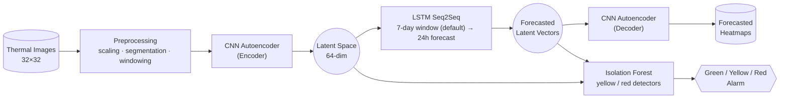

# PANEL360 – Predictive Maintenance via Thermal Imaging

## Problem

Electrical cabinets develop hotspots before they fail, but manual thermal inspections are
infrequent and easy to miss. This project learns normal thermal behavior from historical
panel images, forecasts the next 24 hours, and flags anomalies — turning periodic checks
into continuous, automated monitoring.

## Architecture



- **CNN Autoencoder** — encoder compresses each image through a 64-dimensional bottleneck
  (the latent vector); the same decoder reconstructs heatmaps from latent vectors, observed
  or forecasted.
- **LSTM Seq2Seq** — forecasts the next 24 hourly latent vectors from the last `input_days`
  days of them (7 by default, configurable).
- **Isolation Forest** — two detectors (looser "yellow", stricter "red") trained on latent
  vectors classify each hour, observed or forecasted, as Green/Yellow/Red without hand-set
  temperature thresholds.

## Project layout

```
config/config.ini          # default paths + forecast settings (overridable via PANEL360_* env vars)
src/panel360/
  data.py                  # binary panel loading, scaling, filename->datetime parsing
  augmentation.py          # thermal image rotation/flip augmentation
  timeseries.py            # gap-aware segmentation, resampling, sliding windows, blanking patterns
  anomaly.py               # Isolation Forest alarm classification
  storage/influx.py        # optional InfluxDB writer for anomaly results
  models/
    autoencoder.py         # convolutional autoencoder (CustomAutoencoder, build_autoencoder)
    forecaster.py           # LSTM Seq2Seq forecaster
  pipelines/
    train_autoencoder.py   # trains the autoencoder, extracts latent_vectors.csv
    forecast.py             # forecasts latent vectors, reconstructs heatmaps, flags anomalies
    evaluate.py              # reports reconstruction MSE of a trained autoencoder on held-out data
scripts/                    # thin CLI entry points around the pipelines above
tests/                      # pytest unit tests for the pure-logic modules above
files/                      # expected data layout (32x32 float32 snapshots) — see files/README.md;
                             # real captures are not included (confidential source data)
```

## Setup

Requires Python 3.10 or 3.11 (TensorFlow 2.15 does not support 3.12+).

```bash
python -m venv .venv && source .venv/bin/activate
pip install -e ".[dev]"
```

## Running the pipelines

Run `train_autoencoder` first — `forecast` and `evaluate` both read its model artifacts
(`scaler.joblib`, `convolutional_autoencoder.keras`) back out of `output_folder`.

```bash
python scripts/train_autoencoder.py     # or: panel360-train
python scripts/run_forecast.py          # or: panel360-forecast
python scripts/evaluate_autoencoder.py  # or: panel360-evaluate
```

Paths and the forecast input window come from [config/config.ini](config/config.ini), overridable
per-field via env vars: `PANEL360_BINARY_FOLDER`, `PANEL360_ACTUAL_NEXT24_BINARY_FOLDER`,
`PANEL360_TEST_BINARY_FOLDER`, `PANEL360_OUTPUT_FOLDER`, `PANEL360_INPUT_DAYS`
(and `PANEL360_CONFIG_PATH` for a different ini file entirely).

### Outputs (written to `output_folder`)
- `train_autoencoder`: `scaler.joblib`, `convolutional_autoencoder.keras`, `latent_vectors.csv`,
  `loss_curves.png`, `reconstructed_images.png`
- `forecast`: `forecasted_latent_vectors.csv`, `seq2seq_forecast.keras`, `seq2seq_loss_curves.png`,
  `forecasted_heatmaps/`, `anomaly_forecast_results.csv`, `max_temperatures_with_actual_plot.png`
- `evaluate`: `evaluation_reconstruction.png`

### InfluxDB

The forecast pipeline also writes `anomaly_forecast_results.csv` to InfluxDB — one point per
hour (measurement `panel_status`, tagged by `forecasted`) — for a live dashboard over the alarm
history. The CSV is always written regardless; this is enabled only when all four env vars are
set (install the `influx` extra: `pip install -e ".[influx]"`): `PANEL360_INFLUX_URL`,
`PANEL360_INFLUX_TOKEN`, `PANEL360_INFLUX_ORG`, `PANEL360_INFLUX_BUCKET`.

## Tests

```bash
pytest
```

Covers data loading, augmentation, time-series windowing, anomaly classification, and config —
no TensorFlow required. Model-shape tests in `tests/test_models.py` skip automatically if
TensorFlow isn't installed.

## Docker

Build once, then run each stage as a one-off job (they share the same image):

```bash
docker compose build
docker compose run --rm train
docker compose run --rm forecast
docker compose run --rm evaluate
```

`./files` and `./output` are bind-mounted, so real data can be dropped into `files/` on the host
and results inspected in `output/` without rebuilding. No sample data is bundled — see
[files/README.md](files/README.md) for the expected format.

To also push results to InfluxDB, bring up the `influxdb` service with the same `PANEL360_INFLUX_*`
vars set (a `.env` file next to `docker-compose.yml` works well). `PANEL360_INFLUX_PASSWORD` has no
default — Compose refuses to start the service without it:

```bash
docker compose up -d influxdb
docker compose run --rm forecast
```
